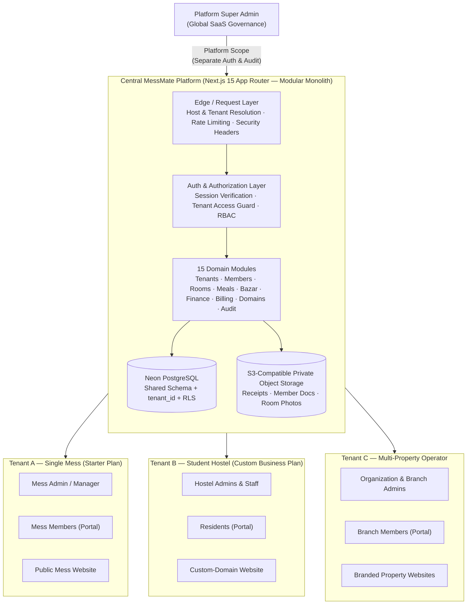

# MessMate — Backend Architecture & Technical Planning

> **Document Status:** Architecture Planning Blueprint (Task 16)  
> **Scope:** Transitioning MessMate from the completed Public Website MVP to a secure, scalable, multi-tenant SaaS platform.  
> **Target Timezone:** `Asia/Dhaka` (`UTC+06:00`)  
> **Currency:** Bangladeshi Taka (`BDT` / `৳`), stored in exact integer minor units (`paisa`, 1 BDT = 100 paisa) or exact fixed-point `NUMERIC(14,2)` — never floating-point.

---

## 1. Existing Project Analysis & Architecture Overview

### 1.1 Verified Current Codebase Baseline

An inspection of the existing MessMate repository confirms the following verified configuration and assets (no backend services, database drivers, or authentication libraries are installed yet):

| Dimension | Verified Current State |
| --- | --- |
| **Framework** | Next.js `15.4.9` (App Router, `output: 'standalone'`, `reactStrictMode: true`, `typescript.ignoreBuildErrors: false`) |
| **Runtime & Language** | React `19.2.1`, React DOM `19.2.1`, TypeScript `5.9.3` (`strict: true`, `target: ES2017`, `moduleResolution: bundler`, `@/* -> ./*`) |
| **Styling & UI** | Tailwind CSS `v4.1.11` (`@tailwindcss/postcss`, `@tailwindcss/typography`, `tw-animate-css`), shadcn/ui `4.23.0` (`style: base-nova`, `rsc: false`, backed by `@base-ui/react ^1.9.0`), `lucide-react ^0.553.0`, `motion ^12.23.24` |
| **Package Manager** | `bun.lock` present; npm scripts: `dev`, `build`, `start`, `lint`, `clean` |
| **Installed Utilities** | `class-variance-authority`, `clsx`, `tailwind-merge`, `@hookform/resolvers ^5.2.1` (note: `zod` and `react-hook-form` are **not** yet installed), `@google/genai ^2.4.0` (template default, unused by public MVP) |
| **Environment Variables** | `.env.example` declares only `GEMINI_API_KEY` and `APP_URL`. No database, auth, storage, or rate-limit variables exist yet. |
| **App Router Routes (15)** | `/`, `/about`, `/contact`, `/design-system`, `/emergency-safety`, `/faq`, `/features`, `/how-it-works`, `/member-portal` (placeholder), `/mess-admin-login` (placeholder), `/pricing`, `/privacy-policy`, `/refund-policy`, `/room-rental`, `/terms` |
| **API Routes** | None (`app/api/` does not exist yet). All forms use client-side validation previews only. |
| **Existing Domain Logic & Tests** | `lib/` contains pure TypeScript helpers (`pricing-config.ts`, `meal-math.ts`, `navigation.ts`, `rental-filter.ts`, `showcase-rental-filter.ts`, `*-validation.ts`, `i18n/*`) covered by 38 passing `node:test` unit tests. |
| **Global Layout Note** | `app/layout.tsx` currently wraps every route with `SiteHeader`, `SiteFooter`, and `ScrollToTopButton`. When authenticated dashboards and tenant websites are introduced, public marketing chrome should be scoped to a `(marketing)` route group layout so all existing public URLs remain intact while dashboards and tenant websites render independent shells. |
| **i18n Setup** | Client-side `LanguageContext` (`en` / `bn`) persisted in `localStorage`. Future backend modules should support user/tenant locale preference (`en` | `bn`) for emails, notices, receipts, and localized validation errors. |
| **Subscription Model (Preserved)** | Two-option model defined in `lib/pricing-config.ts`: **Starter Plan** (exact 7-day free trial → `৳99/month`, single mess, **no automatic renewal or payment without explicit consent**) and **Customized Business Plan** (custom pricing & tailored multi-mess/hostel/multi-property entitlements). |

---

### 1.2 Target System Architecture (Modular Monolith)

MessMate will be built as a **well-structured Modular Monolith** inside the existing Next.js 15 App Router application—avoiding premature microservices while enforcing strict internal module boundaries so domains can scale or extract later if ever required.

The central platform serves **five core operational surfaces** from one codebase:

1. **A. Platform Super Admin (`/super-admin/*`)** — Internal SaaS operations: tenant provisioning/suspension, subscription & manual billing verification, custom business package entitlements, custom domain approvals, platform-wide emergency advisories, global audit log review, and support diagnostics.
2. **B. Mess / Tenant Management Core** — Shared multi-tenant orchestration layer managing tenant lifecycles, slugs, subdomains (`{slug}.messmate.app`), custom domains, plan limits, feature flags, and multi-property organization grouping for Customized Business Plan customers.
3. **C. Mess Admin Dashboard (`/app/[tenantSlug]/*` or subdomain dashboard)** — Day-to-day tenant operations: member onboarding, role/permission assignment, room & seat inventory, daily meal tracking, bazar & shared expense entries, monthly rent/utility billing, payment recording, financial ledger reconciliation, notices, complaints, and tenant website customization.
4. **D. Member Portal (`/portal/[tenantSlug]/*` or tenant subdomain portal)** — Resident self-service: personal profile, meal calendar/opt-in preferences, monthly bill breakdown, payment history/receipts, personal emergency contacts (private), mess notices, and complaint submission.
5. **E. Public Mess Website (`{slug}.messmate.app` or verified custom domain)** — Public-facing customizable website per tenant showcasing mess overview, available room/seat rental listings, public area safety info, house rules, and prospective resident inquiry forms—strictly isolated from private member and financial records.

### 1.3 High-Level Architecture Diagram



---

## 2. Recommended Technology Stack

Only genuinely necessary dependencies are recommended, keeping the runtime lean and compatible with the existing Next.js 15 + React 19 + TypeScript 5.9 codebase:

| Layer | Technology | Rationale & Constraints |
| --- | --- | --- |
| **Full-Stack Framework** | **Next.js 15.4.9 (App Router)** *(existing)* | Co-locates Server Components, Route Handlers (`app/api/v1/*`), Server Actions, and Middleware (`middleware.ts`) in one deployable unit. |
| **Language** | **TypeScript 5.9** *(existing, strict mode)* | End-to-end type safety across Prisma models, Zod schemas, domain services, and React UI. |
| **Database** | **Neon PostgreSQL** *(planned)* | Serverless PostgreSQL with connection pooling (PgBouncer), branching for safe preview/staging migrations, full ACID transactions, and native Row-Level Security (RLS). |
| **ORM & Migrations** | **Prisma ORM** *(planned)* | Type-safe schema & migrations, parameterized queries by default (blocks SQL injection), transaction API (`$transaction`) suitable for RLS `SET LOCAL` context, and client extensions for tenant-scoping guardrails. |
| **Authentication** | **Better Auth** *(recommended — see Section 8 evaluation vs Auth.js)* | First-class TypeScript & Prisma support, native organization/tenant plugins, email/password + phone/OTP extensibility, database-backed revocable sessions, and clean Next.js 15 App Router support. |
| **UI & Styling** | **Tailwind CSS v4 + shadcn/ui (`@base-ui/react`) + Lucide** *(existing)* | Zero rework of the completed design system; reuse existing UI primitives across Admin Dashboard, Member Portal, and Super Admin. |
| **Validation** | **Zod** *(planned)* | Single source of truth for API request bodies, query params, Server Action payloads, form validation (integrates with already-installed `@hookform/resolvers`), and environment variable validation. |
| **File Storage** | **S3-Compatible Private Object Storage** *(Cloudflare R2 or AWS S3)* | Private-by-default bucket storage with zero public exposure for sensitive files (bazar receipts, payment proofs, NID/member docs); served via short-lived server-signed URLs. |
| **Rate Limiting & Short-Lived Cache** | **Upstash Redis** *(or PostgreSQL fallback initially, Redis before public launch)* | Distributed sliding-window rate limiting across serverless/container instances for auth, public inquiry forms, and custom domain lookup caching. |
| **Transactional Email / Notifications** | **Resend** *(or SMTP-compatible provider, pluggable interface)* | Verification emails, member invites, password resets, trial expiry notices, and payment receipts via an abstract `NotificationProvider` adapter. |
| **Date & Timezone Handling** | **`Asia/Dhaka` (`UTC+06:00`)** via standard `Intl` / `date-fns` + `@date-fns/tz` | Store all instants as UTC `TIMESTAMPTZ` in PostgreSQL; store business calendar days (meal date, billing month) as explicit `DATE` / `(year, month)` columns interpreted strictly in `Asia/Dhaka`. |

**Deferred / Explicitly Not Recommended Now:** Microservices, GraphQL, message brokers (Kafka/RabbitMQ), Elasticsearch, or multi-database sharding. Revisit only if real scale demands them.

---

## 3. Multi-Tenant Architecture

MessMate uses a **Shared Application, Shared Database, Shared Schema** multi-tenant model with **defense-in-depth tenant isolation**.

### 3.1 Core Tenant Identification & Hierarchy

- Every mess or independent operational property is represented as a **`Tenant`** with an immutable UUID/ULID primary key (`id`) and a unique URL-safe `slug` (e.g., `lakeview-dhanmondi`).
- **Multi-Property Support (Customized Business Plan):** To support operators running multiple messes, hostels, or branches without breaking single-mess simplicity, an optional parent **`Organization`** (or `BusinessAccount`) can link multiple `Tenant` records. Every operational record (meals, bazar, rooms, bills, ledger) remains strictly scoped to a single `tenant_id`, while authorized Organization Admins can switch between or view aggregated summaries across only the tenants linked to their organization.
- **Public Tenant Resolution:**
  - Platform root domain (`messmate.app` / `www.messmate.app`): Serves the existing MessMate public marketing website.
  - Tenant subdomain (`{slug}.messmate.app`): Resolves to Tenant's Public Website (and optionally tenant-branded login/portal).
  - Verified custom domain (`myhostel.com`): Resolved in Next.js Middleware / Server Component lookup against verified `TenantDomain` records (cached with short TTL and invalidated on domain update).

### 3.2 Four-Layer Tenant Isolation Strategy

A single bug in one layer must never leak another tenant's data:

1. **Layer 1 — Never Trust Client Tenant Inputs:**
   - The server derives the active `tenantId` from the authenticated route/domain context and verifies an active `Membership` row linking `(session.userId, tenantId)` in the database.
   - Any `tenantId`, `role`, or `permission` sent in a JSON body, query string, or custom header is ignored or rejected if it contradicts the verified server context.
2. **Layer 2 — Mandatory `tenant_id` Column & Composite Foreign Keys:**
   - Every tenant-scoped table includes a non-nullable `tenant_id` column indexed as the leading key (`(tenant_id, ...)`).
   - Cross-table relationships within a tenant use **composite foreign keys** referencing `(tenant_id, id)` wherever practical (e.g., `RoomAssignment(tenant_id, room_id) -> Room(tenant_id, id)`), making it mathematically impossible at the database constraint level to associate a member from Tenant A with a room or bill from Tenant B.
3. **Layer 3 — Scoped Data Access Helpers (`withTenantContext`):**
   - Domain services do not call raw global `prisma` directly for tenant-scoped queries. Instead, they execute through a typed tenant-scoped helper (`runInTenantTx(ctx, async (tx) => ...)`) that automatically enforces `tenantId` predicates and opens a database transaction with RLS session variables set.
4. **Layer 4 — PostgreSQL Row-Level Security (RLS):**
   - Enable `ALTER TABLE ... ENABLE ROW LEVEL SECURITY` and `FORCE ROW LEVEL SECURITY` on every tenant-scoped table for the runtime application database role (separate from the migration owner role).
   - Inside every request transaction, execute parameterized `SELECT set_config('app.current_tenant_id', $1, true)` and `SELECT set_config('app.actor_scope', $2, true)` (`is_local = true` so settings automatically clear at transaction commit/rollback — critical for PgBouncer/Neon connection pooling).
   - RLS policies permit rows only when `tenant_id = NULLIF(current_setting('app.current_tenant_id', true), '')::uuid`, with a separate explicit policy path for public website read-only views (e.g., published room listings) and audited Super Admin platform scopes.

### 3.3 Platform Super Admin Isolation

- Super Admin access is stored in a dedicated platform-level flag/table (`PlatformAdmin` / `systemRole`), completely decoupled from tenant `Membership` and tenant `Role` tables.
- Super Admin routes live under an isolated route prefix (`/super-admin/*` and `/api/v1/super-admin/*`) with dedicated middleware, stricter session lifetimes, mandatory MFA (when enabled), IP/user-agent logging, and mandatory **AuditLog** entries for every action (including any explicit "support read" or tenant suspension action).
- A Mess Admin can never escalate into Super Admin; conversely, normal tenant endpoints reject requests unless the actor has verified tenant membership.

---

## 4. Modular Application Architecture (15 Modules)

Each module owns its **validation schemas, domain services, authorization checks, and database queries**. Cross-module communication happens exclusively through exported service functions—never by directly mutating another module's tables.

| # | Module | Core Responsibilities & Boundaries |
| --- | --- | --- |
| **1** | **Authentication** | Sign-up, sign-in, sign-out, password hashing, email/phone verification, password reset, session lifecycle, revocation, MFA readiness, and authenticated actor resolution. |
| **2** | **Users and Profiles** | Global `User` identity (one human account can belong to multiple messes over time), personal profile info, locale preference (`en` / `bn`), avatar asset reference, and user-level private emergency info. |
| **3** | **Tenants and Mess Management** | Tenant creation, slug management, mess profile (name, address, timezone `Asia/Dhaka`, meal rules, billing cycle config), tenant status (`trial`, `active`, `past_due`, `suspended`), public website customization settings, and optional multi-property `Organization` grouping. |
| **4** | **Roles and Permissions** | System default tenant roles (`MESS_OWNER`, `MESS_MANAGER`, `ACCOUNTANT`, `MEMBER`), granular permission registry (`meals:write`, `bazar:approve`, `finance:close_month`, etc.), and custom role definitions for Customized Business Plan tenants. |
| **5** | **Members** | Tenant `Membership` lifecycle (invite token, join approval, active/inactive/left states), move-in/move-out dates, member code, seat/deposit status, and privacy-scoped member directory. |
| **6** | **Rooms and Rental** | Room/seat inventory, capacity, monthly base rent, utility split rules, `RoomAssignment` history, vacant seat tracking, public rental listing publication flag, and prospective tenant rental inquiries. |
| **7** | **Meals** | Daily meal schedules (breakfast/lunch/dinner or configurable slots), member meal opt-in/opt-out cutoffs in `Asia/Dhaka`, guest meals, manager bulk meal entry, daily locks, and monthly meal total aggregation. |
| **8** | **Bazar and Expenses** | Daily bazar shopping logs, itemized `ExpenseItem` rows, shopper assignment, receipt file attachment (private S3), shared utility bills (electricity, gas, water, Wi-Fi, maid/service charges), and approval workflow. |
| **9** | **Finance and Payments** | Monthly billing runs (meal rate calculation using exact integer paisa arithmetic with transparent rounding rule, rent + utility + meal + previous due consolidation), `Bill` generation, `Payment` recording (cash/bKash/Nagad/bank reference), immutable append-only `FinancialLedger`, reversal/adjustment entries, and month-close locking. |
| **10** | **Notices and Community** | Tenant announcements (pinned/targeted notices), house rules, community events, resident `Complaint` / maintenance ticket submission, status tracking, and admin responses. |
| **11** | **Emergency and Safety** | Platform-managed verified Bangladesh national emergency reference records (`999`, `102`, `16263` with source/verification metadata), tenant-managed local emergency directory (landlord, hospital, pharmacy, electrician, security), and strictly private member-level family/guardian emergency contacts. |
| **12** | **Subscription and Billing** | Enforces MessMate's exact two-option business model: **Starter Plan** (exact 7-day free trial → `৳99/month`, explicit opt-in renewal with **zero automatic charging without consent**, read-only grace behavior on expiry) and **Customized Business Plan** (Super Admin managed custom contracts, multi-tenant seat/property quotas, and modular feature entitlements). |
| **13** | **Custom Domains** | Subdomain validation (`{slug}.messmate.app`), custom domain registration (Customized Business Plan entitlement), DNS TXT ownership verification token generation, verification polling, SSL status tracking, and middleware host-to-tenant lookup. |
| **14** | **Audit Logs** | Centralized append-only recorder for security-sensitive and financial mutations (who, when, actor scope, tenant ID, action, target entity/ID, sanitized before/after diff, IP/user-agent hash, request ID). Read-only to Mess Admins (own tenant) and Super Admins (platform-wide). |
| **15** | **Notifications** | Event-driven dispatch (in-app notifications + pluggable email/SMS adapters) for member invitations, monthly bill publication, payment confirmations, trial expiry reminders (e.g., Day 5 & Day 7), notice broadcasts, and complaint updates—respecting user locale (`en`/`bn`). |

---

## 5. Security Architecture

Security controls are enforced strictly on the server across every request path:

### 5.1 Authentication & Session Management
- **Password Hashing:** Argon2id (preferred) or `scrypt` with per-user cryptographically random salts; never store plaintext or weak hashes (MD5/SHA).
- **Session Strategy:** Server-backed, revocable sessions stored in PostgreSQL (with optional short-lived cache) referenced via opaque high-entropy session tokens in `HttpOnly`, `Secure`, `SameSite=Lax` cookies (adjusted appropriately if embedded/cross-subdomain flows require `Partitioned` + explicit Origin verification).
- **Session Hygiene:** Rotate session token on login and privilege changes; support "Sign out all devices"; revoke all active sessions immediately on password reset or account suspension; shorter idle timeout for Platform Super Admin sessions.
- **CSRF Protection:** Verify `Origin` / `Referer` against allowed platform/tenant hosts on all cookie-authenticated state-changing requests (`POST`, `PUT`, `PATCH`, `DELETE`).

### 5.2 Server-Side Authorization & RBAC
- Every Route Handler and Server Action begins with an explicit authorization guard:
  - `requireUser()` — Validates session and returns server-verified `actor`.
  - `requireTenantPermission(tenantSlugOrId, permission)` — Verifies active `Membership`, checks tenant subscription/entitlement status, verifies role grants `permission`, and returns an immutable `TenantAuthContext`.
  - `requireMemberSelfOrPermission(tenantCtx, targetMemberId, permission)` — Ensures Member Portal endpoints can only read/update the signed-in member's own records unless the actor holds an administrative permission.
  - `requireSuperAdmin()` — Verifies active platform Super Admin record independently of tenant roles.
- **Rule of Zero Client Trust:** Client-supplied `tenantId`, `userId`, `role`, `amount`, `mealRate`, or `subscriptionStatus` are never trusted for authorization or financial totals.

### 5.3 Tenant Isolation & Unauthorized Data Access Prevention
- **IDOR Prevention:** Every single-record lookup (`GET /bills/[billId]`, `PATCH /meals/[id]`) filters by **both** `id` and server-verified `tenantId` (plus RLS enforcement at PostgreSQL level). Return `404 Not Found` (not `403`) when a foreign tenant's record ID is probed to prevent cross-tenant existence enumeration.
- **Safe DTO Projection:** Use explicit `select` projections in Prisma queries—never return raw database entities containing password hashes, verification tokens, private emergency contacts, or internal notes.
- **SQL Injection & XSS Safeguards:** All queries use Prisma parameterized APIs (no interpolated raw SQL); React's safe JSX escaping is preserved (no `dangerouslySetInnerHTML` for user/tenant content); all tenant-supplied URLs (social links, custom domains, redirect paths) are strictly parsed and restricted to safe `https:` / relative paths.

### 5.4 Input Validation
- All external inputs (Route Handler JSON bodies, URL params, query strings, Server Action arguments, webhook payloads, and CSV/form data) are parsed through strict **Zod** schemas with explicit string length caps, numeric bounds, enum allowlists, and `.strict()` object checks to prevent mass-assignment attacks.

### 5.5 Secure File Access
- Store all uploaded files (bazar receipts, payment slips, member ID documents, mess/room photos) in an **S3-compatible private bucket** (no public bucket ACLs).
- **Object Key Structure:** `tenants/{tenantId}/{module}/{year}/{month}/{uuid}.{ext}` (never use raw user-supplied filenames or unvalidated paths).
- **Upload Validation:** Server validates authenticated permission, file size limit, allowed MIME types, and magic-byte signature before issuing a single-use short-lived presigned `PUT` URL (or streaming server-side).
- **Download Authorization:** Private documents (receipts, member IDs) are never served via permanent URLs; the server verifies tenant/member permission first, then generates a short-lived presigned `GET` URL (e.g., 60–300 seconds). Only explicitly marked `public_marketing` room photos may be served through a dedicated public CDN/proxy path.

### 5.6 Environment Variable Protection
- Validate all required server secrets at startup via a server-only `config/env.ts` Zod schema (`import 'server-only'`).
- Keep `DATABASE_URL`, `DATABASE_URL_UNPOOLED`, `AUTH_SECRET`, `S3_ACCESS_KEY_ID`, `S3_SECRET_ACCESS_KEY`, `RESEND_API_KEY`, and `REDIS_TOKEN` strictly server-side—**never** prefixed with `NEXT_PUBLIC_`, never committed to git, and never logged in errors.

### 5.7 Rate Limiting
- Apply sliding-window rate limits per IP and per account/session on:
  - Auth endpoints (`/api/auth/*`: sign-in, sign-up, password reset, OTP) — strict limits + exponential backoff to stop credential stuffing.
  - Public forms (homepage contact, custom pricing inquiry, public mess room rental inquiry) — anti-spam limits + honeypot/bot challenge.
  - Authenticated write APIs — reasonable burst/sustained caps per user/tenant.

### 5.8 Audit Logging
- Append-only `AuditLog` entries written inside the same database transaction (where feasible) for: login failures/lockouts, role & permission changes, member removal, room rent changes, bazar edits/approvals, bill generation, payment recording/reversals, month-close locks, subscription changes, custom domain changes, and all Super Admin operations.
- Application role has `INSERT` + `SELECT` only on `audit_logs` (no `UPDATE` or `DELETE`).

### 5.9 Financial Record Protection
- **Exact Money Arithmetic:** All monetary values stored as exact integer **paisa** (`BIGINT`, e.g., `৳99.00` = `9900`) or PostgreSQL `NUMERIC(14,2)`. Existing `lib/meal-math.ts` floating-point preview logic will be replaced on the backend with exact integer/decimal financial math and a documented deterministic rounding policy (any sub-paisa meal-rate remainder tracked explicitly as a transparent rounding adjustment line).
- **Immutable Ledger:** `FinancialLedger` is strictly **append-only**. Posted payments or finalized bills are never hard-deleted or silently overwritten; corrections create explicit `REVERSAL` or `ADJUSTMENT` ledger entries referencing `reverses_entry_id` with an audit reason.
- **Concurrency & Idempotency:** Payment creation and monthly bill generation require client-generated idempotency keys (`Idempotency-Key`) and database unique constraints (e.g., unique `(tenant_id, billing_year, billing_month, membership_id)` per billing cycle) inside `SERIALIZABLE` or row-locked transactions to prevent duplicate charges or double-credited payments.
- **Period Locking:** Once a Mess Admin closes a billing month, historical meal entries and bazar expenses for that closed month become read-only; any subsequent fix is recorded as a next-month adjustment entry.

---

## 6. Database Planning Overview

> **Note:** This is an architectural entity blueprint for planning only—**not** a final Prisma schema and no database tables are created in Task 16.

### 6.1 Data-Isolation Classification

| Isolation Class | Entities | Isolation Rule |
| --- | --- | --- |
| **Platform-Global** | `User`, `Session`, `PlatformAdmin`, `PlanDefinition`, `NationalEmergencyContact`, `PublicLeadInquiry` | Accessible only via Auth, Super Admin, or public read-only catalog APIs. |
| **Organization / Multi-Tenant Root** | `Organization`, `Tenant`, `TenantDomain`, `Subscription`, `SubscriptionInvoice` | Owned by tenant/organization; governed by Super Admin + Tenant Owner. |
| **Tenant-Scoped (RLS Mandatory)** | `Membership`, `Role`, `Permission`, `RolePermission`, `Room`, `RoomAssignment`, `Meal`, `MealEntry`, `BazarExpense`, `ExpenseItem`, `Bill`, `Payment`, `FinancialLedger`, `Notice`, `Complaint`, `MessEmergencyContact`, `FileAsset`, `Notification`, `AuditLog` | Non-nullable `tenant_id` on every row; protected by composite FKs, service guards, and PostgreSQL RLS. |
| **Member-Private (RLS + Owner Scope)** | `MemberEmergencyContact`, member-specific `Bill`/`Payment` views | Tenant-scoped **and** restricted strictly to the owning member (plus authorized admin roles only where explicitly defined by privacy policy). |

### 6.2 Major Planned Entities & Key Relationships

1. **`User`** — Global identity (`id`, `email`, `phone`, `passwordHash`, `fullName`, `locale`, `emailVerifiedAt`, `status`). One `User` can hold multiple `Membership` records across different tenants over time.
2. **`Organization` *(optional parent for Customized Business Plan)*** — Groups multiple `Tenant` properties under one accommodation business (`id`, `name`, `ownerUserId`, `status`).
3. **`Tenant`** — Independent mess or property unit (`id`, `organizationId?`, `slug`, `name`, `businessCategory`, `address`, `timezone` default `'Asia/Dhaka'`, `status`, `websiteConfigJson`, `trialEndsAt`).
4. **`TenantDomain`** — Custom domains and subdomains (`id`, `tenantId`, `hostname` unique, `type` [`SUBDOMAIN` | `CUSTOM`], `verificationToken`, `verificationStatus`, `sslStatus`, `isPrimary`).
5. **`Role` & `Permission` (`RolePermission`)** — Granular RBAC. System permissions are platform-seeded; `Role` rows are tenant-scoped (`tenantId`, `code`, `name`, `isSystemRole`).
6. **`Membership`** — Links `User` ↔ `Tenant` ↔ `Role` (`id`, `tenantId`, `userId`, `roleId`, `status` [`INVITED` | `ACTIVE` | `INACTIVE` | `LEFT`], `joinedAt`, `leftAt`). Unique `(tenantId, userId)` for active membership.
7. **`Room`** — Physical room/seat unit (`id`, `tenantId`, `code`, `roomType`, `capacity`, `baseRentPaisa`, `isPublishedOnWebsite`, `publicSummary`, `status`).
8. **`RoomAssignment`** — Historical and active seat occupancy (`id`, `tenantId`, `roomId`, `membershipId`, `monthlyRentPaisa`, `startDate`, `endDate?`, `isActive`).
9. **`Meal` & `MealEntry`** — `Meal` defines tenant meal configuration/daily cycle (`id`, `tenantId`, `mealDate` `DATE` in `Asia/Dhaka`, `isLocked`); `MealEntry` tracks per-member meal counts (`id`, `tenantId`, `mealId`, `membershipId`, `breakfastUnits`, `lunchUnits`, `dinnerUnits`, `guestUnits`, `recordedByUserId`) using fixed decimals (e.g., `0.5`, `1.0` via `NUMERIC(4,2)` or integer half-meal units).
10. **`BazarExpense` & `ExpenseItem`** — `BazarExpense` records a shopping trip or shared utility expense (`id`, `tenantId`, `expenseDate` `DATE`, `category` [`BAZAR` | `UTILITY` | `MAINTENANCE` | `OTHER`], `totalAmountPaisa`, `paidByMembershipId?`, `receiptFileAssetId?`, `approvalStatus`); `ExpenseItem` stores line items (`id`, `tenantId`, `bazarExpenseId`, `itemName`, `quantityText`, `amountPaisa`).
11. **`Bill`** — Monthly member statement (`id`, `tenantId`, `membershipId`, `billingYear`, `billingMonth`, `openingDuePaisa`, `mealCountUnits`, `mealRatePaisa`, `mealChargePaisa`, `rentChargePaisa`, `utilityChargePaisa`, `otherChargePaisa`, `totalPayablePaisa`, `status` [`DRAFT` | `PUBLISHED` | `SETTLED` | `CLOSED`]).
12. **`Payment`** — Incoming payment or refund recorded against a member/bill (`id`, `tenantId`, `membershipId`, `billId?`, `amountPaisa`, `method` [`CASH` | `BKASH` | `NAGAD` | `BANK` | `OTHER`], `referenceCode?`, `proofFileAssetId?`, `paidAt` `TIMESTAMPTZ`, `idempotencyKey`, `recordedByUserId`).
13. **`FinancialLedger`** — Append-only double-entry/account ledger per tenant (`id`, `tenantId`, `membershipId?`, `entryType` [`BILL_CHARGE` | `PAYMENT_CREDIT` | `DEPOSIT` | `BAZAR_ADVANCE` | `REFUND` | `REVERSAL` | `ADJUSTMENT`], `direction` [`DEBIT` | `CREDIT`], `amountPaisa`, `sourceType`, `sourceId`, `reversesEntryId?`, `note`, `createdAt`, `createdByUserId`).
14. **`Subscription`** — Tenant subscription state (`id`, `tenantId`, `planCode` [`STARTER` | `CUSTOM_BUSINESS`], `status` [`TRIALING` | `ACTIVE` | `EXPIRED` | `SUSPENDED`], `trialStartedAt`, `trialEndsAt`, `currentPeriodStart`, `currentPeriodEnd`, `monthlyFeePaisa` [9900 for Starter; null/custom for Custom], `autoRenew` default `false`, `entitlementsJson`).
15. **`Notice`** — Tenant announcements (`id`, `tenantId`, `title`, `body`, `priority`, `audience` [`ALL_MEMBERS` | `ADMINS_ONLY` | `PUBLIC_WEBSITE`], `publishedAt`, `expiresAt?`, `createdByUserId`).
16. **`Complaint`** — Member issues and maintenance requests (`id`, `tenantId`, `membershipId`, `category`, `subject`, `description`, `status` [`OPEN` | `IN_PROGRESS` | `RESOLVED` | `CLOSED`], `assignedToMembershipId?`, `resolvedAt?`).
17. **`AuditLog`** — Immutable activity log (`id`, `tenantId?`, `actorUserId?`, `actorScope` [`SUPER_ADMIN` | `TENANT_USER` | `SYSTEM`], `action`, `entityType`, `entityId`, `metadataJson`, `ipHash`, `createdAt`).
18. **Supporting Entities:** `MessEmergencyContact` (tenant directory), `MemberEmergencyContact` (strictly private member guardian info), `FileAsset` (S3 metadata + tenant ownership + visibility class), `Notification` (per-user delivery log), and `PublicLeadInquiry` (persisting the existing Homepage Contact, Custom Business Inquiry, and Room Rental Inquiry forms once backend APIs are enabled).

### 6.3 Money & Timezone Standards
- **Money:** Store integer **paisa** (`BIGINT`) across all tables (`totalAmountPaisa`, `rentChargePaisa`, `amountPaisa`). Never use `FLOAT`, `DOUBLE PRECISION`, or JS floating-point currency accumulation.
- **Timezone (`Asia/Dhaka`):** Store event timestamps as UTC `TIMESTAMPTZ`; store calendar-based operational fields (`mealDate`, `expenseDate`, `startDate`, `billingYear`, `billingMonth`) explicitly in `Asia/Dhaka` calendar semantics so a meal logged at `00:15 BDT` is never misattributed to the previous UTC day.

---

## 7. Recommended Project Folder Structure

This layout preserves **all existing frontend directories and routes untouched** while cleanly introducing backend modules, database/auth layers, API routes, and isolated route groups as later tasks are implemented:

```text
/
├── app/
│   ├── layout.tsx                      # Root HTML, fonts, MotionProvider, LanguageProvider
│   ├── globals.css                     # Existing Tailwind v4 styling
│   ├── (marketing)/                    # Optional Phase-2 layout group for SiteHeader/SiteFooter
│   │                                   # (keeps /, /pricing, /about, /faq, /contact, etc. URLs identical)
│   ├── (auth)/                         # Future: /login, /register, /verify, /reset-password
│   ├── (dashboard)/                    # Future: Mess Admin Dashboard (/dashboard/[tenantSlug]/*)
│   ├── (portal)/                       # Future: Member Portal (/portal/[tenantSlug]/*)
│   ├── (super-admin)/                  # Future: Platform Super Admin (/super-admin/*)
│   ├── (tenant-site)/                  # Future: Public Mess Websites (rewritten via subdomain/custom domain)
│   └── api/
│       └── v1/                         # Future REST/JSON Route Handlers (thin HTTP adapters)
│           ├── auth/                   # Auth endpoints
│           ├── tenants/                # Tenant-scoped endpoints
│           ├── portal/                 # Member self-service endpoints
│           ├── public/                 # Public inquiries & public tenant data
│           └── super-admin/            # Platform Super Admin endpoints
├── modules/                            # Domain-driven Modular Monolith (15 modules)
│   ├── auth/                           # Auth adapters, guards, session helpers
│   ├── users/                          # User profile services & DTOs
│   ├── tenants/                        # Tenant & Organization lifecycle
│   ├── rbac/                           # Role/permission checks & seed definitions
│   ├── members/                        # Membership & invitation workflows
│   ├── rooms/                          # Rooms, assignments & public rental listings
│   ├── meals/                          # Daily meal tracking & Dhaka cutoff logic
│   ├── bazar/                          # Bazar & shared expense services
│   ├── finance/                        # Exact paisa math, bills, payments & immutable ledger
│   ├── notices/                        # Notices & complaints
│   ├── safety/                         # National + mess + private emergency services
│   ├── subscriptions/                  # 7-day trial, ৳99/mo Starter & Custom Business entitlements
│   ├── domains/                        # Subdomain & custom domain verification
│   ├── audit/                          # Append-only audit logger
│   └── notifications/                  # In-app + email/SMS notification dispatch
├── server/                             # Shared server-only infrastructure (`import 'server-only'`)
│   ├── auth/                           # Core auth config & permission guards
│   ├── db/                             # Prisma client singleton + `runInTenantTx` (RLS wrapper)
│   ├── storage/                        # S3-compatible private bucket client & presigned URL helper
│   ├── rate-limit/                     # Rate limiter abstraction (Redis / memory dev fallback)
│   ├── http/                           # Standardized API responses, error mapper, idempotency helper
│   └── time/                           # Asia/Dhaka date/month boundary helpers
├── config/
│   ├── env.ts                          # Server-side Zod-validated environment schema
│   └── platform.ts                     # Timezone, currency, upload caps, rate-limit constants
├── prisma/                             # Future (NOT created in Task 16): schema.prisma, migrations/, seed.ts
├── components/                         # Existing shared UI & marketing components (preserved)
├── context/                            # Existing LanguageContext (preserved)
├── data/                               # Existing static marketing datasets & tests (preserved)
├── hooks/                              # Existing React hooks (preserved)
├── lib/                                # Existing client-safe shared utilities, i18n & Zod schemas
├── types/                              # Existing & future shared TypeScript types
├── docs/
│   └── backend-architecture.md         # This architecture specification
└── middleware.ts                       # Future: Host/custom-domain routing & request IDs
```

**Design Rule:** Route Handlers (`app/api/v1/*`) and Server Actions stay **thin**—they only parse input via Zod, invoke the appropriate `server/auth` guard, call a service inside `modules/<domain>/`, and return a typed response.

---

## 8. Authentication Strategy Evaluation: Auth.js vs Better Auth

Before selecting an authentication library for Phase 2, both candidates were evaluated against MessMate's concrete requirements: Next.js 15 App Router, React 19, Prisma + Neon PostgreSQL, Credentials (email/phone + password) login, multi-tenant memberships, revocable database sessions, Super Admin separation, and future mobile/OTP readiness.

| Evaluation Criterion | Auth.js v5 (`next-auth@beta`) | Better Auth (`better-auth`) |
| --- | --- | --- |
| **Email + Password (Credentials) Support** | Historically OAuth-first. Credentials provider disables database sessions by default (forces JWT sessions unless heavily customized), making instant session revocation and password reset flows require significant custom boilerplate. | First-class built-in email/password authentication with secure hashing, email verification, password reset, and **database-backed revocable sessions** out of the box. |
| **Multi-Tenant & Organization Model** | No native multi-tenant or organization abstraction; requires building custom membership/active-tenant session plumbing from scratch. | Official `organization` plugin (or clean custom membership hooks) with active tenant/organization context, invitations, and role hooks built for multi-tenant SaaS. |
| **Prisma + Neon PostgreSQL Fit** | Mature Prisma adapter, though Credentials + DB sessions conflict with default adapter behavior. | Official Prisma adapter with full TypeScript inference and clean database session tables compatible with Neon PostgreSQL. |
| **Next.js 15 App Router & Stability** | v5 has remained in prolonged beta/transition and recently merged governance under the Better Auth ecosystem. | Actively maintained TypeScript-first library with stable Next.js 15 App Router Route Handler & Server Component helpers (`auth.api.getSession({ headers })`). |
| **Super Admin, MFA & Bangladesh Phone/OTP Extensibility** | Requires manual implementation of admin impersonation/ban controls, 2FA, and phone OTP flows. | Built-in optional plugins for `admin` (platform user governance), `twoFactor` (Super Admin MFA), and `phoneNumber` (OTP readiness for Bangladesh users). |
| **Custom Domain / Subdomain Cookie Handling** | Requires manual cookie domain overrides and CSRF tuning across subdomains. | Explicit trusted-origins and cross-subdomain cookie configuration built into core config. |

### Recommendation (Pending Approval)

**Recommend: Better Auth** with Prisma adapter and PostgreSQL database sessions.  
- Directly aligns with MessMate's email/password-first Bangladesh user base (students, bachelors, mess managers who often do not rely on Google OAuth alone), instant session revocation, multi-tenant organization support, and Super Admin 2FA/admin controls—with far less custom security boilerplate than Auth.js v5.
- **Fallback Option:** If strict preference is given to minimal external auth libraries or pure OAuth-first sign-in, Auth.js v5 (with custom JWT revocation blocklist) can still be used, at the cost of extra custom code for credentials, password resets, and session revocation.

---

## 9. Important Technical Risks & Mitigations

| Risk | Severity | Impact | Planned Mitigation |
| --- | --- | --- | --- |
| **1. Neon PgBouncer Pooling vs PostgreSQL RLS** | **High** | Pooled connections are shared across requests; session-level `SET` leaks tenant context to the next request. | Always execute tenant queries inside explicit Prisma transactions using `set_config('app.current_tenant_id', $1, true)` (**transaction-local** `SET LOCAL`), verified by automated cross-tenant integration tests. |
| **2. Cross-Tenant Data Leakage (IDOR / Missing Filter)** | **Critical** | One tenant's admin or member reading/modifying another tenant's bills, meals, or private contacts. | Four-layer defense: server-derived `tenantId`, composite foreign keys `(tenant_id, id)`, mandatory `runInTenantTx` wrapper, and forced PostgreSQL RLS with a non-superuser app role. |
| **3. Floating-Point Financial Drift & Rounding Remainders** | **High** | Meal rate `totalBazar / totalMeals` produces repeating decimals (e.g., `৳64.5161...`), causing member charges not to reconcile with total bazar. | Store all money in integer **paisa** (`BIGINT`), define a single deterministic server rounding policy, and record any sub-taka/paisa reconciliation variance transparently on the monthly settlement summary. |
| **4. RootLayout Coupling Between Public Site & Dashboards** | **Medium** | Current `app/layout.tsx` renders `SiteHeader` and `SiteFooter` globally; dashboards and tenant public websites must not inherit MessMate marketing chrome. | Refactor public pages into `app/(marketing)/layout.tsx` in Phase 1/2 without changing a single public URL path, leaving `app/layout.tsx` minimal (fonts, theme, providers). |
| **5. Custom Domain Routing, SSL & Cookie Scope** | **Medium** | Custom domains (`myhostel.com`) cannot share cookies set on `.messmate.app`, and unverified domains risk host-header spoofing. | Validate hostnames strictly against verified `TenantDomain` records (cached in Redis/memory with short TTL); serve public tenant websites cookie-free while anchoring authenticated dashboards on the central platform domain (or per-domain isolated login). |
| **6. `Asia/Dhaka` Day-Boundary Mismatches** | **Medium** | Servers run in UTC; entries logged between `00:00` and `05:59 BDT` would land on the wrong calendar date if derived from `new Date().toISOString().slice(0,10)`. | Centralize all date-key derivations in `server/time/dhaka.ts` (`Intl.DateTimeFormat('en-CA', { timeZone: 'Asia/Dhaka' })`) and store meal/expense dates as PostgreSQL `DATE`. |
| **7. Trial Expiry & Consent-First Billing Enforcement** | **Medium** | Automatically charging users or locking data abruptly after the 7-day Starter trial violates MessMate's explicit-consent policy. | Enforce `autoRenew = false`; send reminder notifications before Day 7; on trial expiry without explicit subscription, transition tenant cleanly to a read-only grace state allowing data export and manual renewal. |
| **8. Private File Exposure** | **High** | Direct public URLs for member NIDs or payment screenshots expose sensitive PII. | Private S3-compatible bucket with tenant-prefixed UUID keys and short-lived server-authorized presigned URLs only. |

---

## 10. Proposed Backend Development Sequence

A disciplined, incremental rollout where each phase ends with passing unit/integration tests and clean builds:

1. **Phase 1 — Infrastructure & Database Foundation**
   - Install core server dependencies (`prisma`, `@prisma/client`, `zod`, `server-only`, `@date-fns/tz`).
   - Connect Neon PostgreSQL (pooled + unpooled URLs) and configure `config/env.ts`.
   - Author the initial Prisma schema (`User`, `Organization`, `Tenant`, `Membership`, `Role`, `Permission`, `AuditLog`) and PostgreSQL RLS migration SQL + non-superuser app DB role.
   - Refactor `app/(marketing)/layout.tsx` without altering any existing public URLs or homepage UI.
2. **Phase 2 — Authentication, Tenant Context & RBAC Core**
   - Implement approved auth provider (recommended: Better Auth + Prisma adapter).
   - Build `server/auth` guards (`requireUser`, `requireTenantPermission`, `requireSuperAdmin`) and `server/db/tenant-tx.ts` (`runInTenantTx` with RLS).
   - Wire real sign-in/sign-up for `/mess-admin-login` and `/member-portal`, plus tenant onboarding (auto-creating Starter 7-day trial).
   - Add cross-tenant isolation security tests verifying Tenant A can never access Tenant B data.
3. **Phase 3 — Core Mess Operations (Mess Admin Dashboard)**
   - Implement `Members`, `Rooms & Rental`, `Meals` (with `Asia/Dhaka` cutoff rules), `Bazar & Expenses`, `Notices & Complaints`, and `Emergency & Safety` modules.
   - Connect S3-compatible private file uploads for receipts and room photos.
   - Build Mess Admin Dashboard UI using the existing design system and shadcn/ui primitives.
4. **Phase 4 — Financial Engine & Member Portal**
   - Implement exact paisa `Finance & Payments` module (`Bill`, `Payment`, immutable `FinancialLedger`, idempotency keys, month-close locking).
   - Build the Member Portal (personal meals, bills, payments, notices, complaints, and private guardian emergency contacts).
   - Connect existing public inquiry forms (Contact, Custom Business Plan Inquiry, Room Rental Inquiry) to rate-limited `app/api/v1/public/*` endpoints.
5. **Phase 5 — Subscriptions, Public Mess Websites & Custom Domains**
   - Implement `Subscription & Billing` enforcement (7-day Starter trial → explicit-consent `৳99/month` workflow + Customized Business Plan quotas).
   - Implement tenant public website rendering via `{slug}.messmate.app` and `Custom Domains` DNS verification + middleware host routing.
6. **Phase 6 — Platform Super Admin, Notifications & Production Hardening**
   - Build `/super-admin` console (tenant governance, manual subscription verification, custom package provisioning, audit viewer).
   - Enable transactional email/in-app `Notifications`, distributed Redis rate limiting, security header hardening, backup/restore drills, and full end-to-end verification.
