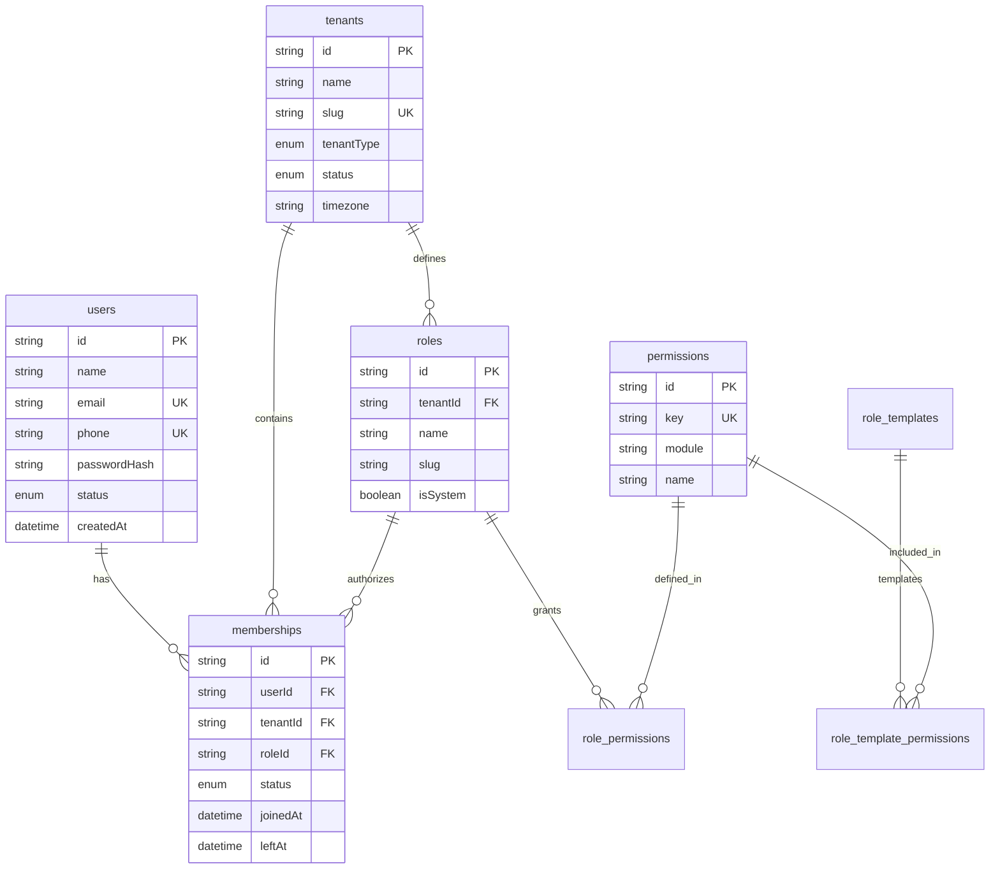

# MessMate — Multi-Tenant Database Architecture & Schema Reference (Tasks 19 & 20)

## 1. Architectural Philosophy

MessMate is a shared-database, shared-schema multi-tenant SaaS. In this model, all independent messes (student messes, bachelor messes, hostels, shared apartments) reside in a single PostgreSQL database, while tenant data is strictly isolated through **relational boundaries**, **compound foreign keys**, and **future PostgreSQL Row-Level Security (RLS)**.

```
Platform
├── Users (Global identity)
├── Tenants / Messes (Independent organizations)
│     ├── Memberships (User <-> Tenant bridge)
│     ├── Roles (Tenant-scoped custom & default roles)
│     └── Role Permissions (Role-specific capability mapping)
└── Permissions (Platform-wide capability definitions)
```

---

## 2. Core Relational Entities

### A. User (`users`)
Represents a global human identity across all messes.
* A user registers **once** on the platform.
* The same user can be an **Owner** in one mess (e.g., "Prince Mess") and a standard **Member** in another mess (e.g., "Green View Hostel").
* User identity is never duplicated when joining additional messes.
* Fields: `id`, `name`, `email` (unique), `phone` (unique), `passwordHash` (nullable for future auth), `status` (`ACTIVE`, `SUSPENDED`, `PENDING`, `INACTIVE`), `emailVerifiedAt`, `phoneVerifiedAt`, `createdAt`, `updatedAt`.

### B. Tenant / Mess (`tenants`)
Represents an independent mess, hostel, or accommodation business.
* Has an immutable `id` and a unique `slug` used for subdomain or URL routing (e.g., `messmate.app/prince-mess`).
* Defaults to `timezone: "Asia/Dhaka"` and `country: "Bangladesh"`.
* Supports tenant categories: `STUDENT_MESS`, `BACHELOR_MESS`, `HOSTEL`, `SHARED_APARTMENT`, `OTHER`.
* Fields: `id`, `name`, `slug` (unique), `description`, `logo`, `coverImage`, `email`, `phone`, `address`, `city`, `country`, `timezone`, `tenantType`, `status`, `createdAt`, `updatedAt`.

### C. Role & RoleTemplate (`roles` & `role_templates`)
* **`RoleTemplate` (Platform Level):** Seeded system blueprints (`Owner`, `Admin`, `Moderator`, `Accountant`, `Meal Manager`, `Member`) defining default baseline permissions.
* **`Role` (Tenant Scoped):** Every active role row belongs strictly to a specific tenant (`tenantId` is non-nullable). When a tenant is created, the system instantiates their tenant roles. A custom role created in Mess A is physically impossible to leak to Mess B.
* **Compound Key:** Role enforces `@@unique([id, tenantId])` to allow child tables to cross-validate tenant scoping via compound foreign keys.

### D. Permission & Junctions (`permissions`, `role_permissions`, `role_template_permissions`)
* Permissions use dot-notated capability keys (e.g., `dashboard.view`, `meals.manage`, `finance.manage`, `bazar.manage`, `rooms.manage`, `notices.manage`).
* 19 granular permissions across 10 functional modules.
* Many-to-many relationship with roles via `RolePermission` and `RoleTemplatePermission`.

### E. Membership (`memberships`)
The bridge linking a `User` to a `Tenant` with an assigned `Role`.
* **Unique Constraint:** `@@unique([userId, tenantId])` ensures a user has exactly one authoritative membership row per mess.
* **Audit Trail:** When a member leaves a mess, their membership status transitions to `LEFT` with a `leftAt` timestamp rather than being deleted, preserving transaction and meal histories.
* **Compound Foreign Key:** `FOREIGN KEY ("roleId", "tenantId") REFERENCES "roles"("id", "tenantId")`. The database engine physically rejects any attempt to assign a role from Tenant B to a membership in Tenant A!

---

## 3. Relational Schema Diagram (Mermaid)



---

## 4. Cross-Tenant Isolation Guarantees

1. **Compound Foreign Key Enforcement:**
   ```sql
   ALTER TABLE "memberships"
     ADD CONSTRAINT "memberships_roleId_tenantId_fkey"
     FOREIGN KEY ("roleId", "tenantId")
     REFERENCES "roles"("id", "tenantId")
     ON DELETE RESTRICT ON UPDATE CASCADE;
   ```
2. **Deterministic Unique Membership Index:**
   ```sql
   CREATE UNIQUE INDEX "memberships_userId_tenantId_key"
     ON "memberships"("userId", "tenantId");
   ```
3. **PostgreSQL RLS Preparation:**
   All future tables (e.g., `meals`, `bazar_expenses`, `rooms`, `payments`) will include `tenantId String` with foreign key to `tenants(id)`. When Row-Level Security is enabled in upcoming tasks, PostgreSQL policies will enforce:
   ```sql
   CREATE POLICY tenant_isolation_policy ON meals
     FOR ALL
     USING (tenant_id = NULLIF(current_setting('app.current_tenant_id', true), '')::text);
   ```

---

## 5. Idempotent Seed Strategy

The seed script (`prisma/seed.ts`):
1. Safely checks if `DATABASE_URL` is configured.
2. Uses Prisma `upsert` on all 19 permissions.
3. Uses Prisma `upsert` on all 6 system role templates.
4. Mappings are idempotent: running `npm run db:seed` multiple times will never duplicate or clobber records.
5. Does not create fake real-world users or messes in the production seed.

---

## 6. How to Deploy Migrations to Neon

When your actual Neon PostgreSQL connection string is set in `.env`:
```bash
# 1. Test connectivity
npm run db:check

# 2. Apply the migration to Neon
npx prisma migrate deploy

# 3. Seed default permissions and role templates
npm run db:seed
```
